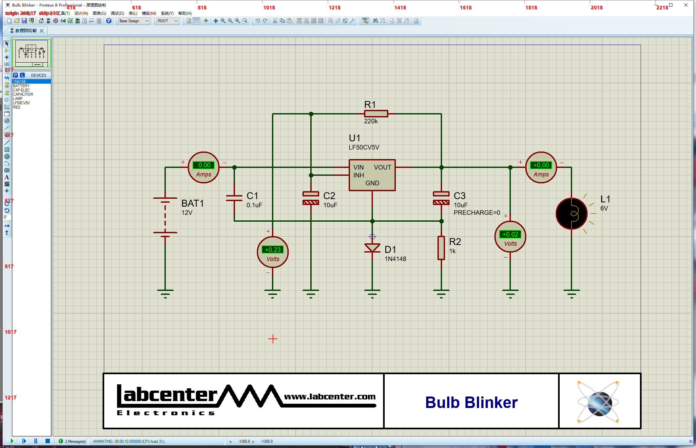

# dsh-proteus-bridge


DeepSeek Harness（Cordis）工具插件：让 Agent 控制 **Proteus 8 / 9** 的交互仿真并保存工程。



*上图：Proteus 8.17 里一个真实的 `Bulb Blinker` 工程正在交互仿真，电压/电流探针实时读数。插件负责的是「Agent 侧」——连接、启停、状态、保存；原理图本身是人工画的。*

插件对外只暴露一套工具，内部按本机能力自动选择传输层：

| 传输 | 触发条件 | 能力 |
| --- | --- | --- |
| `com` | 系统注册了 `Labcenter.InteractiveSimulation` COM 服务器 | 仿真生命周期、信号读取、原理图编辑（放置/引脚/连线）、保存 |
| `ui` | 未注册 COM（**shipping Proteus 8.17 就是这种情况**） | 仿真生命周期、状态探测、工程保存、布局建议 |

`proteus_connect` 会明确回传 `transport` 字段，不做静默降级：拿到 `ui` 就说明本机只能走键盘驱动路径。

## 工具一览

| 工具 | COM | UI |
| --- | --- | --- |
| `proteus_connect` | ✅ | ✅ |
| `proteus_sim_start` / `proteus_sim_stop` / `proteus_sim_status` | ✅ | ✅ |
| `proteus_save_schematic` | ✅ | ✅ |
| `proteus_suggest_layout` | ✅ | ✅（纯本地计算，不需连接） |
| `proteus_read_signals` | ✅ | ⛔ `UNSUPPORTED_ON_TRANSPORT` |
| `proteus_list_placeable_components` / `proteus_place_component` | ✅ | ⛔ `UNSUPPORTED_ON_TRANSPORT` |
| `proteus_query_pins` / `proteus_connect_pins` | ✅ | ⛔ `UNSUPPORTED_ON_TRANSPORT` |

UI 传输下被拒绝的工具返回的是**领域失败**（`ok:false` + `code` + `hint`），不是异常：

```
PROTEUS UNSUPPORTED_ON_TRANSPORT: proteus_query_pins 在 UI 传输下不可用（shipping Proteus 无原理图脚本接口）
hint: UI 传输只覆盖仿真生命周期与保存
```

## 安装

```bash
dsh plugin add dsh-proteus-bridge
```

插件通过 `cordis.patch.yml` 注册进 profile 组合：

```yaml
- insert:
    - id: dsh-proteus-bridge
      name: dsh-proteus-bridge
```

## UI 传输怎么工作

`lib/ui/uibroker.js` 内嵌一段 PowerShell 5.1 + C# 脚本，作为**持久子进程**运行（不是每次调用起一个）。它只提供原子原语，组合逻辑在 `lib/session.js`：

- **附着**：按窗口标题子串 `Proteus 8 Professional` 找主窗口；找不到就 `spawn` `PDS.EXE` + 工程路径，6 次 × 5 s 轮询。
- **前台投递**：先发一次裸 `ALT`（`keybd_event` 0x12 down/up）解掉 Windows 前台锁，再 `AttachThreadInput` + `SetForegroundWindow`。只做后者时 `SetForegroundWindow` 会返回 `true` 而前台窗口不变，随后持续 `FOREGROUND_FAILED`。窗口最小化时先 `SW_RESTORE`（最小化矩形是 `-32000` 级哨兵值，在上面算点击坐标会把鼠标扔到屏幕外）；仍抢不到则兜底 `SwitchToThisWindow`。
- **状态探测**：`WM_CANCELMODE` → 3 次 `F10` + `Right×6`（调试菜单）+ `Down` → `GetMenuState(576/581/582)`。三键全为 `0x100` 说明菜单没刷新，重试；`582&3` → `idle`，`581&3` → `paused`，否则 `running`。
- **保存**：`Ctrl+S` 之后轮询 `#32770` 对话框并 `BM_CLICK` 命中 `确定/OK/是/继续` 的按钮（Proteus 8.17 会弹「File will be saved in version 8.17 format…」）。**不点掉它，文件根本不会落盘，而且它占住前台让后续所有注键失败。**
- **落盘校验**：保存前后各取一次 `{size, mtimeMs, sha256}`，内容与 mtime 都没变就返回 `SAVE_NOT_APPLIED`，绝不谎报成功。
- **按键表**（8.17 实测）：`F12` 运行/恢复 · `Pause` 暂停 · `Shift+Pause` 停止 · `Ctrl+F12` 开始仿真 · `Ctrl+S` 保存。菜单导航一律不用字母键（中文 IME 会拦），也不向工具栏发 `TB_*` 消息（越界索引会把 32 位 comctl32 写崩）。

## 0.4.3 修了什么

1. **Proteus 装在 C:/D: 以外盘符时连不上** —— 旧实现只硬编码 `C:\`/`D:\` 四个 `PDS.EXE` 候选。本机装在 `E:\Program Files (x86)\...`，候选全落空 → `findProteusExe()` 返回 `null` → 空路径被甩给 PowerShell，`Get-Item -LiteralPath ''` 的参数绑定异常顶替了真正的原因，用户看到一句 PowerShell 报错而不是「没找到 PDS.EXE」。改为 App Paths → 卸载项 `InstallLocation` → `A:`–`Z:` × 常见尾段三段探测，命中前先 `stat` 校验；空路径直接抛 `PROTEUS_NOT_INSTALLED`，PowerShell 失败抛新增的 `PROTEUS_VERSION_PROBE_FAILED`。

## 0.4.2 修了什么

三个新缺陷，同样在 Proteus 8.17.37159 上实测复现并验证修复，详见 [CHANGELOG.md](./CHANGELOG.md)。

1. **`fail()` 也会产出非法输出** —— 0.4.1 只修了 `suggestLayout`，没意识到 `fail()` 是同一个坑的通用出口：无条件写 `hint`/`details`，code 没有 hint 映射时留下值为 `undefined` 的自有属性，宿主直接拒收整个结果，Agent 连 `code`/`message` 都看不到。改为条件写入，并顺手清掉 `timeSeconds`、`bytes.before/after` 两处同类隐患。
2. **`proteus_sim_start` 点了没反应** —— Animation 工具栏按钮在 `idle` 时是禁用的。改为 `F12` 优先（工具栏兜底），`simStop` 改走 `Shift+Pause` → 菜单停止 → 工具栏三级回退，每步都用 `probe` 轮询目标态。
3. **窗口最小化后全部 UI 操作失效** —— 最小化时 `GetWindowRect` 返回 `-32000` 级哨兵值（实测 `-25600`），抢前台拿不到、点击落到屏幕外。`Foreground` 增加 `SW_RESTORE` 前置与 `SwitchToThisWindow` 兜底，新增 `HasUsableRect` 断言，不再静默失败。

## 0.4.1 修了什么

三个都在 Proteus 8.17.37159 上实测复现并验证修复，详见 [CHANGELOG.md](./CHANGELOG.md)。

1. **`proteus_suggest_layout` 被宿主判为非法输出** —— `partition: group.label || undefined` 会留下一个值为 `undefined` 的自有属性，宿主的无损 JSON 快照（`snapshotJsonValue`）直接拒绝，报 `value is not lossless JSON`。改成只在标签非空时才写 `partition` 键。
2. **`FOREGROUND_FAILED`** —— 前台投递缺裸 `ALT` 解锁（见上）。
3. **`proteus_save_schematic` 谎报成功** —— 不处理格式确认框，`ok:true` 返回时文件 mtime 未变；对话框还占住前台，把后续所有工具一起带崩。

## 自检

```bash
node test/selfcheck.mjs
```

29 项：8 个布局用例（含 `refs:['R1']` 这种单件、`columns`/`gridMm` 覆盖、带未匹配前缀的分区）+ `fail()` 无损性 + 仿真原语顺序 + 最小化恢复 + PowerShell 补丁存在性 + 保存判据源码断言。不连 Proteus、不需要宿主进程。

## 器件白名单

`whitelist/placeable.v1.json` 的 `components` 是**脚本可放置**的器件集合，必须逐个在真机上验证「放置 → 保存 → 重开」都成立才加入。空数组表示还没有验证过的器件，不是缺陷；此时 `proteus_place_component` 返回 `COMPONENT_NOT_IN_PLACEABLE_WHITELIST`。

## 已知限制

- shipping Proteus 8.17 **不含 COM 服务器**（`WINCORE.DLL` 无类型库），所以本机恒为 `ui` 传输，原理图编辑能力不可用。
- UI 传输的菜单坐标按 8.17 SP2 实测（调试菜单为第 7 项）；其它 build 需复核。
- `proteus_save_schematic` 的 `overwrite` / `confirmRollback` 只对 COM 传输有意义；UI 传输下走 Ctrl+S，`overwrite` 语义由 Proteus 自己的备份机制承担。

## License

MIT
